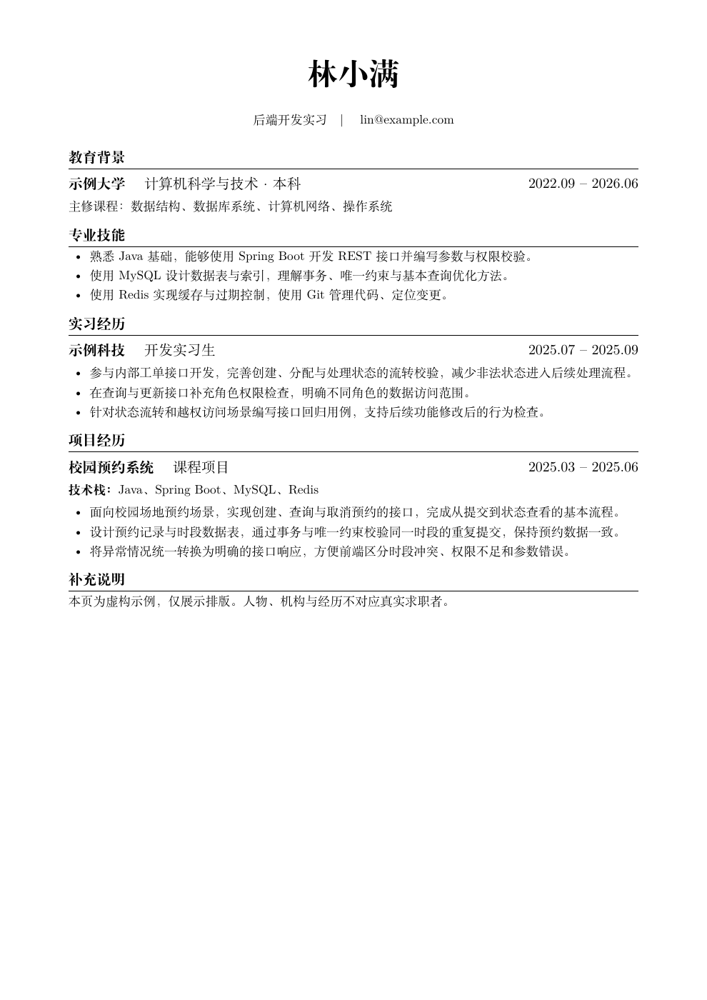

# AI 自动生成简历

**把旧简历、项目资料和招聘要求交给 AI，生成用 LaTeX 排版的 PDF 简历。**

不用自己写 LaTeX。你提供材料，AI 整理内容、调整排版，你检查后再投递。

[开始使用](#怎么用) · [看看生成的简历](docs/preview.pdf) · [电脑需要装什么](docs/setup.md) · [遇到问题](docs/faq.md)

## 怎么用

你需要一个能读取电脑文件、运行命令的 AI 助手，例如 Codex。普通网页聊天窗口不能直接操作你的电脑。

### 1. 把这段话发给 AI

```text
请下载 https://github.com/Kidding-Ma/ai-auto-resume 到当前工作区的独立文件夹，先读里面的 AGENTS.md。
检查我电脑上的工具，已有的直接用，不要重复安装或覆盖配置。
告诉我应该把材料放在哪个文件夹，等我放好后再开始。
```

你也可以点击本页上方的 **Code → Download ZIP**，解压后用 AI 助手打开文件夹，再让它阅读 `AGENTS.md`。

### 2. 放材料

AI 会告诉你 `materials` 文件夹的位置。把已有文件放进去就行，不用重新整理格式。

```text
materials/
  旧简历.pdf
  实习记录.docx
  项目介绍.md
  招聘要求.txt
```

不必每种材料都有。没有旧简历，写几段自己的教育和工作经历也可以。项目代码可以另放一个文件夹，把路径告诉 AI。[不知道放什么？看这里](docs/materials.md)

### 3. 告诉 AI 你想投什么岗位

```text
材料放好了，开始生成。我想投后端开发岗位。
请帮我写简历、排版并生成 PDF。能从材料里查到的信息不要重复问，不能确认的内容不要编。
```

把“后端开发”换成你的目标岗位。有招聘要求就一起提供，AI 会据此选择简历中要突出的经历。

完成后，打开 `output/resume.pdf`。**核对姓名、联系方式、日期和经历，再拿去投递。**

## 能帮你做什么

- **从零写简历**：从旧简历、实习记录和项目资料中整理出一份完整简历。
- **按招聘要求修改**：选择相关的经历，写清楚你做过什么、怎么做的。
- **从代码里找项目亮点**：有项目代码时，结合代码和提交记录分析你的贡献。
- **排成 PDF**：使用 Overleaf 中文简历模板，默认按一页 A4 排版。
- **准备面试**：根据简历整理项目介绍和可能被问到的问题。

没有依据的数字不会凭空补上；缺少信息时会列出来，请你确认。

## 生成的简历长这样

下面是虚构示例，姓名、学校、公司和经历都不对应真实求职者。

<a href="docs/preview.pdf"></a>

## 生成后还能继续改

直接告诉 AI：

```text
这份太长了，帮我压到一页。
按新的招聘要求再改一版。
这段项目经历没说清楚，重点写我负责的部分。
帮我准备面试官可能追问的 8 个问题。
```

生成的文件都在 `output` 文件夹里：

| 文件 | 内容 |
| --- | --- |
| `resume.pdf` | 排好版的简历 |
| `resume.tex` | 可继续修改的 LaTeX 文件 |
| `resume.md` | 可复制到招聘网站的简历文字 |
| `review.md` | 需要确认的信息和修改建议 |
| `interview.md` | 项目介绍和面试问题 |

## 电脑需要装什么

让 AI 先检查，**已经能用的就不用再装**。

- 已有可用的 LaTeX 环境：直接用。本模板用 XeLaTeX 生成 PDF，不限定 MiKTeX。
- 已有 VS Code 和可用的 LaTeX 插件：直接用。AI 通过命令生成 PDF 时，不需要编辑器插件。
- 缺少工具：AI 会说明缺什么，再按[准备教程](docs/setup.md)补齐。

本项目不提供 AI 服务，需要使用你自己的 AI 助手。第一次生成 PDF 可能需要联网下载字体和排版组件。

## 材料会公开吗

**本项目不会自动把你的材料或简历上传到 GitHub。** `materials`、`workspace` 和 `output` 中的个人文件默认不提交到 Git；公开仓库只放模板、教程和虚构示例。

使用云端 AI 时，助手读取的内容可能发送给你选择的 AI 服务。不要放密码、身份证号码或未经允许分享的公司资料。

## 反馈和参与

遇到问题，可以[提一个 Issue](https://github.com/Kidding-Ma/ai-auto-resume/issues/new/choose)。写清楚卡在哪一步，贴报错前删掉个人信息。

如果它帮你省下了改简历的时间，欢迎点个 **Star**，或者分享给正在找工作的朋友。想一起改进，见[贡献说明](CONTRIBUTING.md)。

## 致谢

项目经历分析使用 [resume-project-miner](https://github.com/auberginewly/resume-project-miner)。模板基于 [billryan/resume](https://github.com/billryan/resume)，与 [Overleaf 中文简历模板](https://www.overleaf.com/latex/templates/chinese-resume-template-zhong-wen-jian-li-mo-ban/fbdypsjmgwbb)使用同一类模板，已调整为适合本地编译的字体配置。

新增代码和文档采用 MIT 许可。第三方内容的来源、修改和许可见 [THIRD_PARTY_NOTICES.md](THIRD_PARTY_NOTICES.md)。
