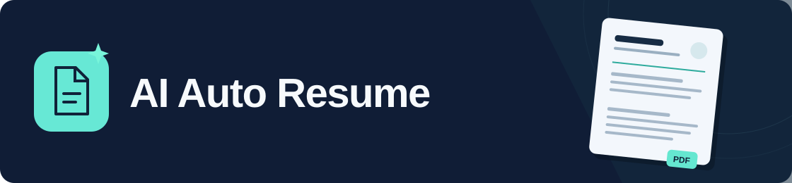
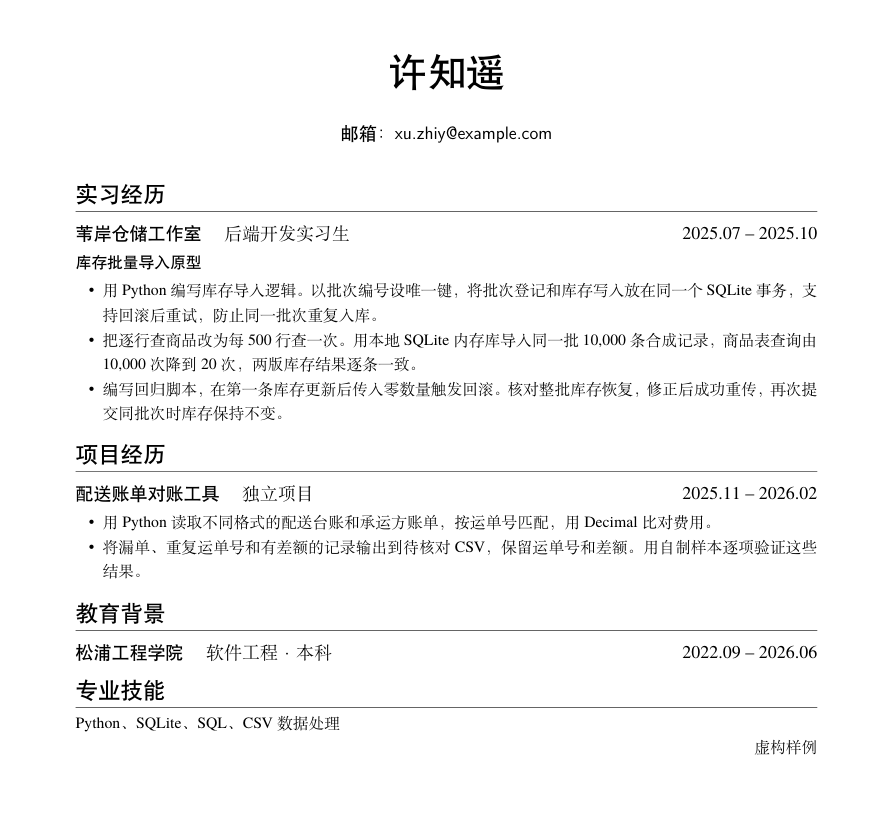

<p align="center"></p>

<h1 align="center">AI 自动生成简历</h1>

手里有旧简历、项目笔记，或者几行个人情况，就能开始。把材料放进文件夹，发一句话，拿到排好版的 **PDF 简历和可编辑 TeX**。AI 会从零散记录里梳理你的分工，把具体做法和有依据的成果写进简历。

**[开始使用](#开始使用)** · [打开样例 PDF](docs/preview.pdf) · [查看样例材料](examples/materials.md) · [English](docs/README.en.md)

<p align="center">
  <a href="https://github.com/Kidding-Ma/ai-auto-resume/stargazers"></a>
  <a href="https://github.com/Kidding-Ma/ai-auto-resume/actions/workflows/check.yml"></a>
  <a href="LICENSE"></a>
</p>

[](docs/preview.pdf)

## 开始使用

**1. 把现有材料放进 AI 助手打开的文件夹。** 旧简历、项目笔记、代码和招聘要求都可以直接放。第一次写简历，就在 `个人情况.txt` 里写几行教育、做过的事、本人负责的部分和用过的技能。有多少写多少。

**2. 复制这句话发给 AI。**

```text
按 https://github.com/Kidding-Ma/ai-auto-resume 的最新 AGENTS.md，用当前文件夹的材料生成排版好的 PDF 简历和可编辑 TeX。
```

推荐 **VS Code + Codex**。OpenCode + DeepSeek、DeepSeek Harness 或其他能读写本地文件、运行命令的助手也可以。已有 XeLaTeX、编辑器和插件直接用，缺哪项再补。[使用帮助](docs/help.md)

打开原文件夹 `output/` 里的成品，投递前核对事实和联系方式。项目脚本只在本地运行，云端 AI 读取材料时由所用服务处理。

[模板与写作参考](THIRD_PARTY_NOTICES.md) · [验证记录](docs/validation.md) · [反馈问题](https://github.com/Kidding-Ma/ai-auto-resume/issues/new/choose) · [收藏项目](https://github.com/Kidding-Ma/ai-auto-resume/stargazers)
