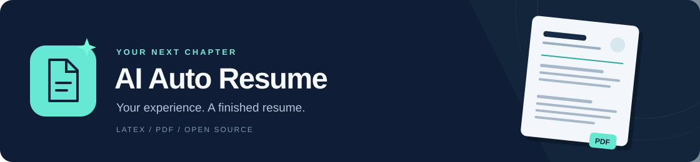
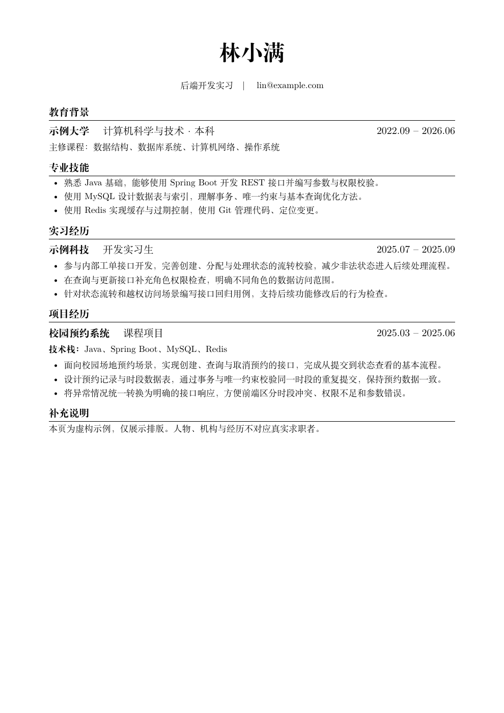

<p align="center"></p>

<h1 align="center">AI Auto Resume</h1>
<p align="center">One prompt to create a high-quality resume from your own materials.</p>
<p align="center"><a href="../README.md">简体中文</a> · <strong>English</strong></p>

<p align="center">
  <a href="https://github.com/Kidding-Ma/ai-auto-resume/stargazers"></a>
  <a href="https://github.com/Kidding-Ma/ai-auto-resume/actions/workflows/check.yml"></a>
  <a href="../LICENSE"></a>
  
  
</p>

<p align="center"><a href="#get-started">Get started</a> · <a href="preview.pdf">Sample PDF</a> · <a href="faq.md">FAQ (Chinese)</a></p>

The preview below is a fictional Chinese-language sample. Its name, school, company and experience do not belong to a real applicant.

[](preview.pdf)

## Get started

Put your existing resume or project notes in your workspace. Starting from scratch? Create `about-me.txt` and write a few lines:

```text
Education: school, major, degree and dates
Experience: jobs, coursework, competitions or volunteering; what you did
Skills: what you have learned and actually used
Name and contact details: add when ready
Target role: optional
```

Use what you have; leave the rest blank. If you want a photo, put it in the same workspace.

Open that folder in your AI assistant and send:

```text
Use this project to create my resume: https://github.com/Kidding-Ma/ai-auto-resume
My personal details and supporting materials are in the current workspace.
Read the project's AGENTS.md and its writing and review rules. Use the fixed template to create an English PDF resume.
Reuse existing tools. Tell me if anything essential is missing.
Do not invent experience or numbers.
```

When it finishes, open `output/resume.pdf` and check your details before applying. Ask for a different resume language if needed.

We recommend **VS Code + Codex**. OpenCode, DeepSeek Harness and other assistants work with the same prompt if they can read local files and run commands.

Reuse your existing LaTeX installation, editor and extensions. You do not need to install them again. If no usable LaTeX installation exists, the assistant will explain what is needed; it cannot generate a PDF through a chat-only interface.

To revise the result, say “Fit it on one page” or “Tailor it to this job description.”

The assistant selects sections from your evidence, omits generic summaries by default, keeps explanatory parentheses to a minimum and puts award levels first. Sparse information still produces a reviewable draft, without invented metrics or experience. Options such as “keep my wording” or “academic focus” are optional; generation starts without a questionnaire.

## Tools, if needed

The template uses XeLaTeX. MiKTeX, TeX Live and MacTeX can provide it; let your assistant check what is already installed before adding anything. VS Code and a LaTeX extension are optional when your assistant compiles from the command line. Python 3.10+ is optional for the included helper scripts.

PDF layout tests pass on Windows with MiKTeX and in Linux CI with TeX Live. Individual AI clients and macOS have not all been tested end to end.

More help in Chinese: [Materials](materials.md) · [Setup](setup.md) · [FAQ](faq.md).

## Privacy and credits

Do not upload personal materials or generated resumes to a public repository. This project does not automatically upload files. If you use a cloud AI service, the content it reads may be sent to that service. Check the facts in your resume before sending it to employers.

- Project experience analysis: [resume-project-miner](https://github.com/auberginewly/resume-project-miner) by auberginewly, included in this repository.
- Fixed layout: [Overleaf Chinese Resume Template](https://cn.overleaf.com/latex/templates/chinese-resume-template-zhong-wen-jian-li-mo-ban/fbdypsjmgwbb) by xiangrongjingujiu, CC BY 4.0. Original layout parameters with open-font substitutions and a page-centred photo header.
- Writing methods: [Reactive Resume](https://github.com/reactive-resume/reactive-resume) and [ResumeSkills](https://github.com/Paramchoudhary/ResumeSkills). See [sources and credits](../THIRD_PARTY_NOTICES.md) for methods and licenses.

[Code license](../LICENSE) · [Sources and credits](../THIRD_PARTY_NOTICES.md) · [Contributing](../CONTRIBUTING.md) · [Report an issue](https://github.com/Kidding-Ma/ai-auto-resume/issues/new/choose)

If this helps you, a Star would mean a lot. Good luck with your applications!

