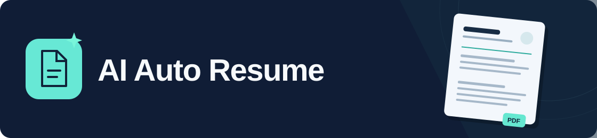
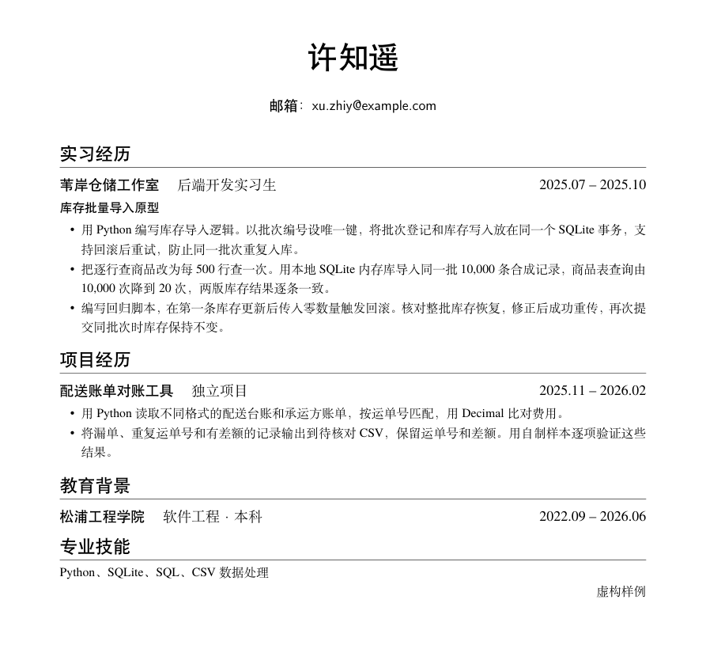

<p align="center"></p>

<h1 align="center">AI Auto Resume</h1>

Start with an old resume, project notes, or a few lines about yourself. Put them in a folder and send one prompt to get a **typeset PDF resume and editable TeX**. The assistant uses your notes to describe what you contributed and what came of it.

**[Get started](#get-started)** · [Open the sample PDF](preview.pdf) · [Read the sample notes](../examples/materials.md) · [简体中文](../README.md)

<p align="center">
  <a href="https://github.com/Kidding-Ma/ai-auto-resume/stargazers"></a>
  <a href="https://github.com/Kidding-Ma/ai-auto-resume/actions/workflows/check.yml"></a>
  <a href="../LICENSE"></a>
</p>

[](preview.pdf)

## Get started

**1. Put your materials in the folder opened by your AI assistant.** Use an old resume, project notes, code, or a job description. Starting from scratch? Add a few lines to `about-me.txt` about your education, what you did, your part in it, and the skills you used.

**2. Copy this prompt.**

```text
Follow the latest AGENTS.md at https://github.com/Kidding-Ma/ai-auto-resume and use my current folder to produce a typeset English PDF resume and editable TeX.
```

We recommend **VS Code + Codex**. OpenCode + DeepSeek, DeepSeek Harness, and other assistants that can read and write local files and run commands also work. Reuse your XeLaTeX, editor, and extensions. Add only what is missing. [Help in Chinese](help.md)

Open the finished files in `output/` in your original folder. Check the facts and contact details before applying. The scripts run locally. Materials read by a cloud AI assistant are processed by that service.

[Template and writing sources](../THIRD_PARTY_NOTICES.md) · [Validation in Chinese](validation.md) · [Report an issue](https://github.com/Kidding-Ma/ai-auto-resume/issues/new/choose) · [Star the project](https://github.com/Kidding-Ma/ai-auto-resume/stargazers)
